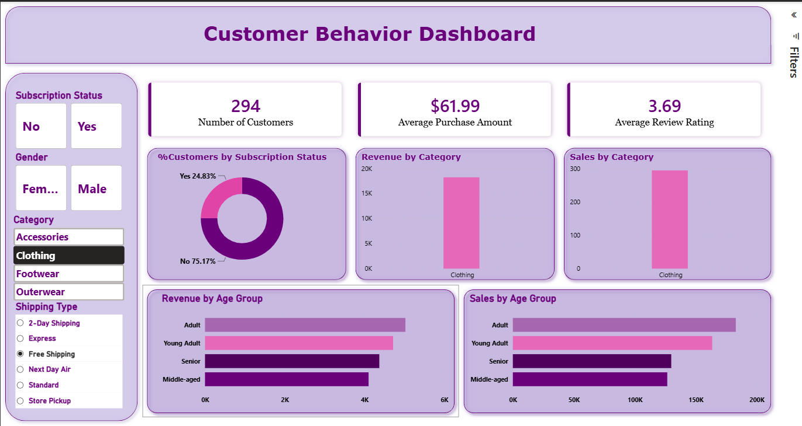

# Customer Shopping Behavior Analysis

A complete end-to-end data analytics project — from raw data to an interactive dashboard — covering data cleaning, exploratory analysis, SQL-based business analysis, and dashboard/reporting deliverables.

---

## 📌 Overview

This project analyzes customer shopping behavior using transactional retail data. The goal is to uncover insights into spending patterns, customer segments, product preferences, and subscription behavior in order to support data-driven business decisions.

The workflow covers the full analytics pipeline:
**Python (EDA & Cleaning) → SQL (Business Analysis) → Power BI (Dashboard) → Report & Presentation**

---

## 🗂️ Dataset

- **Rows:** 3,900 transactions
- **Columns:** 18
- **Key features:**
  - Customer demographics (Age, Gender, Location, Subscription Status)
  - Purchase details (Item Purchased, Category, Purchase Amount, Season, Size, Color)
  - Shopping behavior (Discount Applied, Promo Code Used, Previous Purchases, Frequency of Purchases, Review Rating, Shipping Type)
- **Data quality note:** 37 missing values identified in the Review Rating column and handled during cleaning.

---

## 🛠️ Tools & Technologies

| Category | Tools |
|---|---|
| Programming | Python (pandas) |
| Database | PostgreSQL / MySQL / SQL Server |
| Visualization | Power BI |
| Presentation | Gamma (exported to PowerPoint) |
| Environment | Jupyter Notebook |

---

## 🔄 Project Steps

### 1. Data Loading & Exploration
- Imported the dataset using `pandas`
- Used `df.info()` and `df.describe()` to understand structure and summary statistics

### 2. Data Cleaning
- Identified and imputed missing values in the Review Rating column using the median rating per product category
- Standardized column names to snake_case for consistency
- Checked for redundant columns (e.g., verified overlap between Discount Applied and Promo Code Used) and removed duplicates

### 3. Feature Engineering
- Created an `age_group` column by binning customer ages into segments
- Created a `purchase_frequency_days` column to quantify purchase cadence numerically

### 4. Database Integration
- Connected the cleaned Python DataFrame to a SQL database (PostgreSQL / MySQL / SQL Server)
- Loaded the dataset into a relational table for structured querying

### 5. SQL Analysis
Performed business-focused SQL queries to answer key questions, including:
- Revenue by gender
- High-spending customers who used discounts
- Top-rated products
- Shipping type comparison
- Subscriber vs. non-subscriber spending behavior
- Discount-dependent products
- Customer segmentation (New, Returning, Loyal)
- Top products per category
- Repeat buyer and subscription correlation
- Revenue by age group

### 6. Dashboard Development
- Built an interactive Power BI dashboard to visualize key metrics and trends
- Included filters for subscription status, gender, category, and shipping type

### 7. Presentation
- Created a summary presentation in Gamma for stakeholders (`Customer_Shopping_Behavior_Analysis_1.pptx`)

---

## 📊 Dashboard

The Power BI dashboard provides an interactive view of:
- Total customers, average purchase amount, and average review rating
- Revenue and sales breakdown by category
- Revenue and sales breakdown by age group
- Customer distribution by subscription status


Filtered to **Clothing** with **Free Shipping**, showing 294 customers, an average purchase of $61.99 and 24.8% subscribers:



Slicers for subscription status, gender, category and shipping type filter every visual on the page.

**Known issue:** the *Sales by Age Group* chart uses *Sum of customer_id*, so it adds up ID numbers (axis up to 2M) instead of counting customers. Change the field's aggregation to **Count**, or use the `Number of Customers` measure, which is what *Sales by Category* already shows (about 1.7K for Clothing).

---

## 📈 Key Results

- Male customers generated significantly higher total revenue than female customers
- "Loyal" customers make up the majority of the customer base (~80%)
- Young Adults contributed the highest revenue among all age groups
- Certain products (e.g., Hat, Sneakers, Coat) show strong dependency on discounts to drive sales
- Non-subscribers generate a larger share of total revenue than subscribers, despite similar average spend

---

## 💡 Business Recommendations

- **Boost subscriptions** by promoting exclusive member benefits
- **Strengthen loyalty programs** to convert returning customers into loyal customers
- **Review discount strategy** to protect margins on discount-dependent products
- **Prioritize top-rated and best-selling products** in marketing campaigns
- **Target high-revenue age groups** with tailored marketing efforts

---

## ▶️ How to Run

### Prerequisites
- Python 3.x
- Jupyter Notebook (via Anaconda recommended)
- PostgreSQL / MySQL / SQL Server installed and running
- Power BI Desktop

### Setup

```bash
# Clone the repository
git clone https://github.com/ramaalmoujahed/Power_BI.git
cd Power_BI/Customer_Shopping_Behavior_Analysis

# Install required Python packages (PostgreSQL driver; use pymysql or pyodbc for MySQL / SQL Server)
pip install pandas sqlalchemy psycopg2-binary jupyter
```

### Running the Analysis

1. Open `Customer_Shopping_Behavior_Analysis.ipynb` and run the data cleaning and EDA cells. The notebook reads `customer_shopping_behavior.csv` from the same folder.
2. Create a database named `customer_behavior`, then fill in your own connection details (username, password, host, port) in the database cell. The notebook has cells for PostgreSQL, MySQL and SQL Server: run only the one you use.
3. Run that cell to load the cleaned DataFrame into a table called `customer`.
4. Run the queries in `customer_shopping_behavior.sql` against the database. They use PostgreSQL syntax, e.g. `::numeric` casts and `LIMIT`.
5. Open `customer_behavior_dashboard.pbix` in Power BI Desktop. It reads the `public.customer` table from PostgreSQL. To refresh, go to **Transform data → Data source settings** and point it to your server.
6. Open `Customer_Shopping_Behavior_Analysis_1.pptx` for the summary presentation.

---

## 📁 Project Structure

```
Customer_Shopping_Behavior_Analysis/
├── customer_shopping_behavior.csv          raw dataset (3,900 rows × 18 columns)
├── Customer_Shopping_Behavior_Analysis.ipynb   cleaning, EDA, feature engineering, database load
├── customer_shopping_behavior.sql          10 business questions in SQL (PostgreSQL)
├── customer_behavior_dashboard.pbix        Power BI dashboard
├── Customer_Shopping_Behavior_Analysis_1.pptx  summary presentation
├── screenshots/
│   ├── dashboard.png                       full dashboard
│   └── dashboard_filtered.png              filtered to Clothing + Free Shipping
└── README.md
```

| Missing item | Status |
|---|---|
| Written report (PDF) | Mentioned in the project plan but not in the repository |

---

## ⚠️ Note on credentials

The PostgreSQL cell in the notebook contains a hard-coded password. Before sharing the notebook, replace it with a placeholder or read it from an environment variable, e.g. `os.environ["PGPASSWORD"]`. If that password is used anywhere else, change it.

---

## 📬 Contact

For questions or collaboration opportunities, reach out on [GitHub](https://github.com/ramaalmoujahed).
