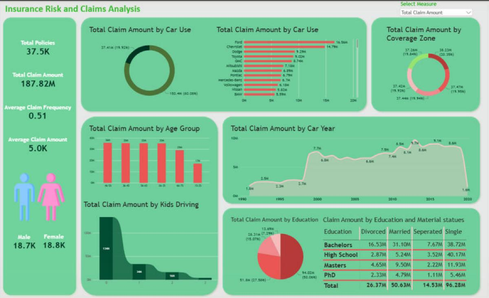

# Insurance Risk & Claims Analysis — Power BI

An interactive Power BI dashboard that analyzes car-insurance policies and claims: how many policies there are, how much is paid out, and how claims differ by vehicle, region and policyholder profile. The dataset is demo data with synthetic values, not real customer records.



## Overview

The report is a single-page dashboard built on one table of **37,542 policy records**. A KPI panel on the left summarizes the business at a glance, and eight charts break claims down by car use, car make, coverage zone, age group, kids driving, car year, education, and education × marital status.

A **"Select Measure" dropdown** (built with a Power BI field parameter) switches every chart between **Total Claim Amount** and **Total Policies**, so the same page answers both "where does the money go?" and "where are our customers?". Clicking any segment cross-filters the whole report.

## Business questions

**KPIs**
- **Total Policies:** how large is the active customer base?
- **Total Claim Amount:** what is the overall financial impact of claims?
- **Average Claim Frequency:** how often do policyholders file claims?
- **Average Claim Amount:** how severe is a typical claim, and what is the exposure per claim?
- **Policies by Gender:** how is the customer base split between male and female policyholders?

**Charts** (each switchable between claim amount and policy count)
| Question | Visual |
|---|---|
| How do claims differ between private and commercial vehicles? | Donut chart: Car Use |
| Which car brands carry the most claims? | Bar chart: Car Make |
| Is risk concentrated in particular regions? | Donut chart: Coverage Zone |
| Which age brackets file the most claims? | Column chart (histogram): Age Group |
| How do young drivers in the household affect claims? | Ribbon chart: Kids Driving |
| How does the car's manufacturing year relate to claims? | Area chart: Car Year (1991 onwards) |
| How do claims vary by education level? | Pie chart: Education |
| Which education × marital-status profiles claim the most? | Matrix heat map |

## Key insights (Total Claim Amount view)

- **$187.8M** in total claims across 37,542 policies. The average claim is about **$5,000** and the average claim frequency is **0.51**.
- **Private vehicles account for 80%** of all claim payouts ($150.4M vs. $37.4M for commercial).
- **Ford ($16.6M) and Chevrolet ($14.8M)** lead the 78 car makes by claim amount.
- **Coverage zones are almost perfectly balanced** at about 20% each, so geography isn't a differentiating risk factor in this dataset.
- **Ages 26–65 drive the volume**, at about $35M per 10-year bracket. The youngest group (15–25) claims about half as much.
- **71% of claims come from households with no kids driving.** Claim amounts fall steadily as the number of young drivers rises, which mostly reflects how many such households exist.
- **Newer cars dominate:** vehicles built before 2000 account for under 15% of claims from 1991 onwards, and the peak is around model year 2013.
- **Single policyholders with a High School ($40.2M) or Bachelor's ($38.7M) education** are the two largest segments in the education × marital-status matrix.
- **The gender split is almost exactly 50/50** (18,736 male and 18,806 female policies).

## Data preparation

- **Import:** the Excel workbook was loaded with Power Query (Get Data → Excel Workbook) and the row count was validated against the source (37,542 rows).
- **Quality check:** Column Quality and Column Distribution were reviewed in Power Query. All columns are 100% valid with 0% errors and no empty values, so no cleaning steps were needed. `ID` was confirmed as the unique row identifier, with one duplicated value, which was kept as-is.
- **Calculated columns:** two columns were added in DAX for the age analysis:
  - **Age:** calculated from `BirthDate` up to today's date.
  - **Age Group:** 10-year buckets (15–25, 26–35, 36–45, 46–55, 56–65, 66–75, 76+).

> Because **Age** uses `TODAY()`, age-group figures shift slightly over time as policyholders get older.

## Data model

A single-table model (`insurance_data_car`) plus a field-parameter table (`Select Measure`). No relationships are required.

## DAX

| Name | Type | Purpose |
|---|---|---|
| Total Policies | Measure | Count of policy IDs |
| Total Claim Amount | Measure | Sum of claim amounts ($) |
| Average Claim Amount | Measure | Average claim amount ($) |
| Average Claim Frequency | Measure | Average number of claims per policy |
| Male Count / Female Count | Measures | Policies by gender |
| Age | Calculated column | Policyholder age from birth date |
| Age Group | Calculated column | 10-year age buckets |
| Select Measure | Field parameter | Switches charts between Total Claim Amount and Total Policies |

Full formulas: [`measures/Insurance_Measures.md`](measures/Insurance_Measures.md)

## Dashboard design

- **Layout:** custom 2200 × 1350 canvas with rounded panels that group related visuals, in a green colour theme throughout.
- **KPI panel:** a vertical multi-card for the four headline KPIs, plus male/female counts shown with icons.
- **Dynamic charts:** every chart takes its value from the `Select Measure` field parameter, so chart titles and values update when the measure changes.
- **Heat map:** the matrix uses conditional-formatting background colours to highlight the largest education × marital-status segments.
- **Interactions:** visual interactions are set to **filter** instead of highlight, so selecting a car make, age group or zone filters the entire page.

## Repository structure

```
Insurance-Risk-Claims-Analysis/
├── Insurance_Risk_Claims_Analysis.pbix
├── README.md                 (this file)
├── data/
│   ├── README.md             (data dictionary)
│   └── insurance_policies_data.xlsx
├── measures/
│   └── Insurance_Measures.md (all DAX formulas)
└── screenshots/
    └── dashboard.png
```

## How to use

1. Download the repository and open `Insurance_Risk_Claims_Analysis.pbix` in **Power BI Desktop**.
2. If Power BI can't find the data, go to **Transform data → Data source settings** and point the source to `data/insurance_policies_data.xlsx`, then click **Refresh**.
3. Use the **Select Measure** dropdown at the top right to switch between claim amounts and policy counts, and click any chart segment to filter the page.

## Tools

Power BI Desktop · Power Query · DAX (measures, calculated columns, field parameters) · Excel

## Skills demonstrated

KPI design · DAX measures and calculated columns · Field parameters for dynamic measure switching · Data quality validation in Power Query · Binning / histogram analysis · Conditional formatting · Dashboard layout and visual design · Cross-filtering interactions
