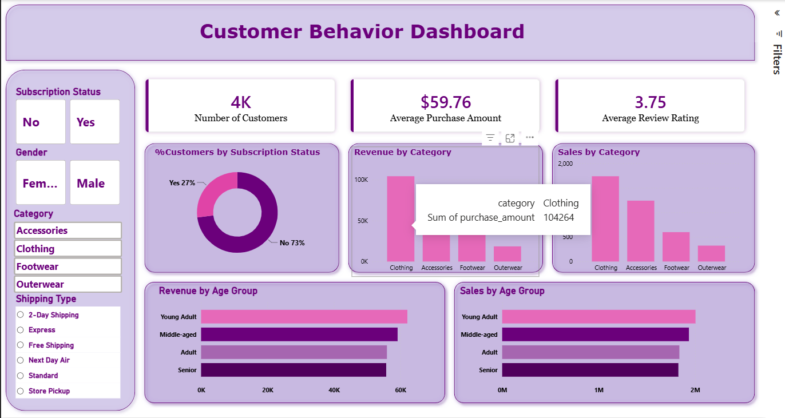

# Power BI Portfolio

A collection of end-to-end Power BI dashboards built on business datasets: banking, HR, finance, insurance, supply chain and retail. Each project folder contains the `.pbix` report and, where available, the source data, the DAX measures, the extraction queries and screenshots of every report page.

> All datasets are training, demo or synthetic data. None of them contain real customer, employee or company records.

## Projects

| # | Project | Domain | Pages | Highlights |
|---|---|---|---|---|
| 1 | [SAMSUNG Supply Chain & Logistics](SAMSUNG-PowerBI-Analysis/) | Supply chain | 6 | Star schema with 5 fact and 5 dimension tables, 30 DAX measures, page navigation, supplier / inventory / shipment / customer views |
| 2 | [Insurance Risk & Claims Analysis](Insurance-Risk-Claims-Analysis/) | Insurance | 1 | 37.5K policies, field parameter to switch every chart between claim amount and policy count, heat-map matrix |
| 3 | [Human Resources Analysis](Human%20Resources%20Analysis/) | HR | 3 | 3,520 employees, two dynamic measure selectors, time-intelligence salary comparison, dimension switcher table |
| 4 | [America Bank Analysis](America_Bank/) | Banking | 4 | ~4K customers, US shape map, balance and loan analysis, dynamic measure and dimension selectors |
| 5 | [Financials Analysis](Financials-PowerBI-Analysis/) | Finance | 4 | Sales, COGS, margin and profit KPIs, custom tooltip page with sparklines, map and measure selector |
| 6 | [Customer Shopping Behavior](Customer_Shopping_Behavior_Analysis/) | Retail | 1 | Full pipeline: Python cleaning → PostgreSQL analysis (10 business questions) → Power BI dashboard → presentation |

## Previews

| SAMSUNG Supply Chain | Insurance Risk & Claims |
|---|---|
|  |  |
| **Human Resources** | **America Bank** |
|  |  |
| **Customer Shopping Behavior** | |
|  | |

## Skills demonstrated

- **Data modeling:** star schemas, fact and dimension tables, one-to-many relationships, dedicated measure tables, date tables
- **DAX:** aggregations, `CALCULATE` with filters, `DIVIDE`, variables, time intelligence (`SAMEPERIODLASTYEAR`), `SWITCH`-based dynamic measures, calculated columns
- **Interactivity:** field parameters, disconnected slicer tables for measure and dimension switching, page navigation, bookmarks and buttons, report-page tooltips, cross-filtering
- **Data preparation:** Power Query, data quality checks, Python (pandas) cleaning, SQL analysis
- **Design:** KPI cards, custom themes, shape maps, conditional formatting, consistent layouts
- **Documentation:** extracting tables, measures and queries from `.pbix` models with DAX Studio and VertiPaq Analyzer

## Tools

Power BI Desktop · Power Query · DAX · DAX Studio · Excel · Python (pandas, SQLAlchemy) · PostgreSQL · Jupyter

## Repository structure

```
Power_BI/
├── SAMSUNG-PowerBI-Analysis/            supply chain dashboard + CSV star schema
├── Insurance-Risk-Claims-Analysis/      insurance claims dashboard
├── Human Resources Analysis/            HR dashboard + extracted model
├── America_Bank/                        banking dashboard + extracted model
├── Financials-PowerBI-Analysis/         financial performance dashboard
├── Customer_Shopping_Behavior_Analysis/ Python + SQL + Power BI project
└── README.md                            (this file)
```

Most project folders follow the same layout:

| Folder | Contents |
|---|---|
| `*.pbix` | The Power BI report |
| `data/` | Source tables and a data dictionary |
| `measures/` | Every DAX measure with its formula and purpose |
| `queries/` | DAX queries used to extract data from the model |
| `screenshots/` | One image per report page |

## How to open a report

1. Install [Power BI Desktop](https://powerbi.microsoft.com/desktop/) (Windows, free).
2. Clone or download this repository.
3. Open the `.pbix` file in a project folder. The data is already imported, so the report works without a refresh.
4. To refresh, go to **Transform data → Data source settings** and point each source to the files in that project's `data/` folder.
